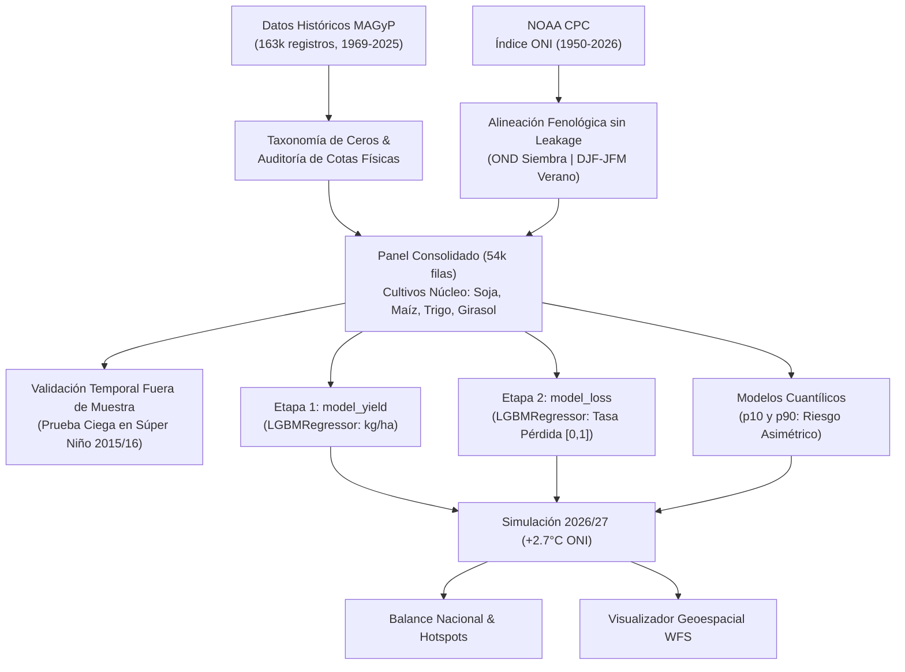
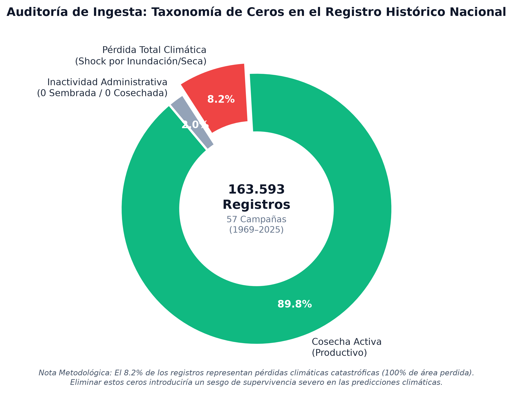
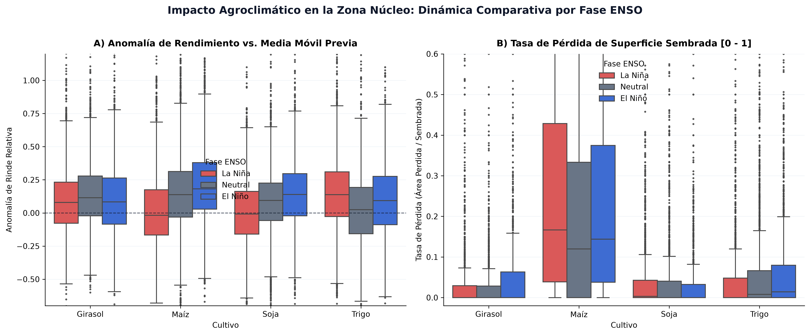
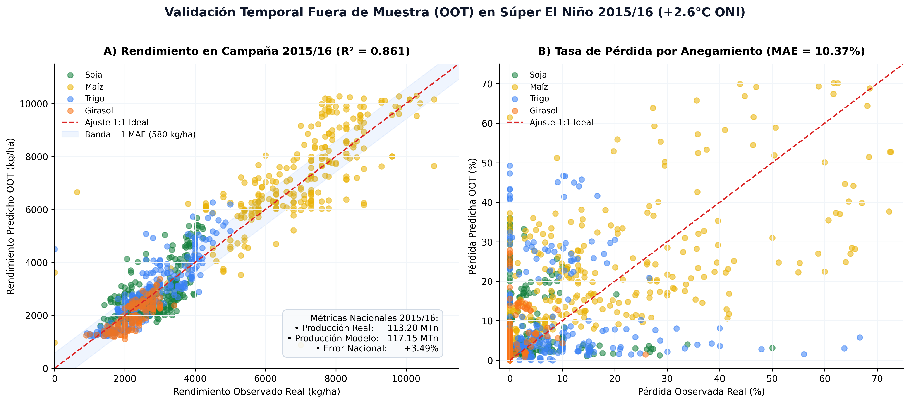
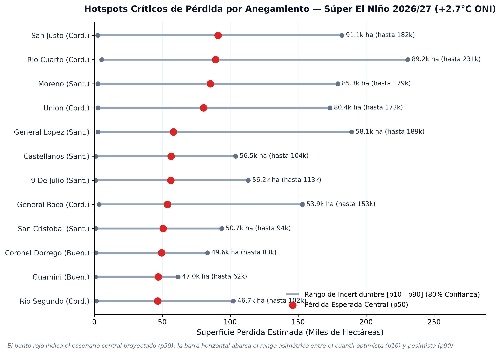

# 🌊 NIÑO-PREDICT: Modelado Predictivo Agroclimático & Simulación Súper El Niño 2026/2027

[](https://www.python.org/)
[](https://lightgbm.readthedocs.io/)
[](notebooks/mapa_inundaciones_2026.html)
[](https://www.magyp.gob.ar/)
[](LICENSE)

Plataforma de **Machine Learning y análisis agroclimático** para cuantificar el impacto físico y económico de un evento extremo de **Súper El Niño ($+2.7^\circ\text{C}$ ONI en el Pacífico ecuatorial)** sobre la producción agrícola argentina de la campaña **2026/2027**.

El proyecto abarca **57 campañas agrícolas oficiales (1969–2025/26)** de la Secretaría de Agricultura, Ganadería y Pesca (MAGyP) combinadas con el Índice Oceánico de El Niño (ONI) de NOAA, cubriendo **317 departamentos agrícolas** y los 4 cultivos pilares de Argentina: **Soja, Maíz, Trigo y Girasol**.

---

## 🎯 Hallazgos Clave de la Simulación 2026/2027

Bajo un escenario proyectado de calentamiento oceánico extremo ($+2.7^\circ\text{C}$ ONI en verano y $+2.4^\circ\text{C}$ en siembra):

| Indicador Agronómico | Estimación Central ($p50$) | Rango de Incertidumbre [$p10 - p90$] | Contexto e Impacto |
| :--- | :---: | :---: | :--- |
| **Superficie Sembrada Nacional** | **$36.71\text{ Mha}$** | - | Portafolio base 4 cultivos principales (1.073 combinaciones depto-cultivo) |
| **Superficie Perdida por Anegamiento** | **$3.06\text{ Mha}$** | **$[0.10\text{ Mha} - 6.71\text{ Mha}]$** | $8.33\%$ de pérdida física nacional por inundación y falta de piso |
| **Producción Nacional Neta** | **$150.73\text{ MTn}$** | **$[97.52\text{ MTn} - 194.97\text{ MTn}]$** | Volumen histórico récord impulsado por rindes máximos en lomas bien drenadas |
| **Pérdida en Maíz (El más vulnerable)** | **$2.12\text{ Mha}$** ($19.87\%$) | **$[0.10\text{ Mha} - 4.26\text{ Mha}]$** | Producción: $63.28\text{ MTn}$ (Rinde: $7.399\text{ kg/ha}$). Cosecha tardía atrapada en el barro |
| **Pérdida en Soja** | **$0.61\text{ Mha}$** ($3.61\%$) | **$[0.00\text{ Mha} - 1.59\text{ Mha}]$** | Producción: $56.43\text{ MTn}$ (Rinde: $3.459\text{ kg/ha}$). Mayor plasticidad y cosecha previa a picos |
| **Pérdida en Trigo** | **$0.28\text{ Mha}$** ($4.26\%$) | **$[0.00\text{ Mha} - 0.76\text{ Mha}]$** | Producción: $24.42\text{ MTn}$ (Rinde: $3.862\text{ kg/ha}$). Excesos hídricos en espigazón primaveral |
| **Pérdida en Girasol** | **$0.05\text{ Mha}$** ($1.79\%$) | **$[0.00\text{ Mha} - 0.10\text{ Mha}]$** | Producción: $6.60\text{ MTn}$ (Rinde: $2.680\text{ kg/ha}$). Resistencia relativa en suelos arenosos |

> **La Paradoja del Súper Niño:** El evento produce simultáneamente una **cosecha nacional récord de 150.7 MTn** (gracias a rindes excepcionales en suelos drenados) y **catástrofes localizadas con 3.06 millones de hectáreas bajo agua** en los bajos y cuencas endorreicas (pudiendo escalar a 6.7 Mha en el escenario pesimista $p90$).

---

## 🗺️ Mapa Interactivo Departamental (Modo Oscuro)

El proyecto incluye un visualizador geoespacial completo en **Leaflet / Folium** estilizado en **CartoDB Dark Matter**, accesible en [`notebooks/mapa_inundaciones_2026.html`](notebooks/mapa_inundaciones_2026.html):

* **4 Capas Temáticas Conmutables:**
  1. 🌊 *Tasa de Pérdida Global (%)*
  2. ⚠️ *Superficie Perdida Total (Ha) con alertas por severidad*
  3. 🌽 *Pérdida Específica Maíz (%)*
  4. 🌱 *Pérdida Específica Soja (%)*
* **Tarjetas Emergentes (Popups):** Detalle por departamento con hectáreas sembradas, producción estimada en kTn, rendimientos esperados en kg/ha y bandas de incertidumbre al 80% de confianza $[p10 - p90]$.

---

## 🔬 Metodología & Arquitectura de Machine Learning

El proyecto implementa un **modelo acoplado de dos etapas (*Two-Stage Hurdle Architecture*)**:



### Validación Temporal Fuera de Muestra (OOT)
Antes de proyectar 2026/27, el modelo fue entrenado estrictamente con datos de **1969 a 2014** y evaluado a ciegas sobre el **Súper El Niño real de 2015/2016 (+2.6°C ONI)**:
* **$R^2$ de Rendimiento:** **$0.861$** ($86.1\%$ de varianza explicada).
* **MAE de Rendimiento:** **$580.1\text{ kg/ha}$**.
* **MAE en Tasa de Pérdida:** **$10.37\%$**.
* **Error en Producción Nacional Agregada:** **solo $+3.49\%$** ($117.15\text{ MTn}$ proyectadas vs. $113.20\text{ MTn}$ reales).

---

## 📊 Galería de Visualizaciones de Publicación

Las siguientes figuras vectoriales y de alta resolución (300 DPI) son generadas automáticamente en `reports/figures/`:

| Figura | Descripción |
| :---: | :--- |
|  | **Figura 1: Taxonomía de Ceros en 163.593 Registros:** Demuestra visualmente por qué el $8.2\%$ de ceros representa siniestros climáticos catastróficos que deben conservarse. |
|  | **Figura 2: Impacto Asimétrico por Fase ENSO:** Distribución de anomalías de rinde vs. tasa de pérdida en la Zona Núcleo para La Niña, Neutral y El Niño. |
|  | **Figura 3: Matriz de Validación Ciega OOT (Súper El Niño 2015/16):** Dispersión 1:1 de rendimientos y pérdidas departamentales observadas vs. predichas. |
|  | **Figura 4: Hotspots Críticos con Bandas de Incertidumbre $[p10 - p90]$:** Ranking de los 12 departamentos con mayor superficie en riesgo de inundación para 2026/27. |

---

## 📁 Estructura del Repositorio

```text
nino-predict/
│
├── data/
│   ├── raw/
│   │   ├── Estimaciones.csv              # Registro histórico oficial MAGyP (1969–2025/26)
│   │   └── oni_noaa.csv                  # Serie temporal del Oceanic Niño Index (NOAA)
│   └── processed/
│       ├── dataset_consolidado_57campanas.parquet # Panel analítico depurado (54k filas)
│       └── df_2026_super_nino.csv        # Salida de la simulación con cuantiles p10, p50, p90
│
├── notebooks/
│   ├── 01_eda_limpieza_datos.ipynb       # Ingesta, auditoría física de ceros y cruce climático
│   ├── 02_modelado_simulacion_super_nino.ipynb # Two-Stage LightGBM, validación 2015/16 y simulación
│   └── mapa_inundaciones_2026.html       # Visualizador interactivo 100% en Modo Oscuro
│
├── reports/
│   └── figures/                          # Gráficos de publicación en PNG (300 DPI) y SVG
│       ├── fig_01_taxonomia_ceros.png
│       ├── fig_02_enso_distribucion_anomalias.png
│       ├── fig_03_validacion_oot_2015_16.png
│       └── fig_04_hotspots_anegamiento_2026.png
│
├── scripts/
│   ├── build_map.py                      # Generador del mapa interactivo Leaflet
│   └── download_nasa.py                  # Extractor modular para la API NASA POWER
│
├── requirements.txt                      # Dependencias del entorno
├── .gitignore                            # Exclusión de archivos temporales y capas pesadas
└── README.md
```

---

## 🚀 Instalación y Reproducción

### 1. Clonar el Repositorio
```bash
git clone https://github.com/Nicocarello/nino-predict.git
cd nino-predict
```

### 2. Configurar el Entorno Virtual
```bash
python -m venv venv
# En Windows:
venv\Scripts\activate
# En Linux/Mac:
source venv/bin/activate

pip install -r requirements.txt
```

### 3. Ejecutar los Notebooks
1. **Paso 1:** Ejecutar `notebooks/01_eda_limpieza_datos.ipynb` para sanear la serie histórica y exportar el dataset consolidado.
2. **Paso 2:** Ejecutar `notebooks/02_modelado_simulacion_super_nino.ipynb` para entrenar los modelos, validar en 2015/16 y proyectar la campaña 2026/27.
3. **Paso 3:** Abrir `notebooks/mapa_inundaciones_2026.html` en cualquier navegador web para explorar el mapa interactivo.

---

## 📚 Fuentes de Datos & Referencias

* **MAGyP:** Secretaría de Agricultura, Ganadería y Pesca de la República Argentina — *Estimaciones Agrícolas Oficiales*.
* **NOAA Climate Prediction Center (CPC):** *Oceanic Niño Index (ONI)*, Cold & Warm Episodes by Season.
* **INDEC:** Instituto Nacional de Estadística y Censos — *Capas de Delimitación Político-Territorial Departamental*.

---

## ⚠️ Descargo de Responsabilidad (Disclaimer)

* **Propósito Analítico y de Divulgación:** Este proyecto es un desarrollo técnico de modelado estadístico, Machine Learning y simulación prospectiva de escenarios extremos (*stress-testing* agroclimático) con fines estrictamente académicos, analíticos y de investigación en ciencia de datos.
* **No constituye Pronóstico Operativo Oficial:** Las proyecciones presentadas no reemplazan ni constituyen pronósticos meteorológicos o climáticos oficiales. Toda toma de decisión agronómica, logística o de siembra debe contrastarse con los informes, alertas y estimaciones emitidas por los organismos oficiales competentes: el **Servicio Meteorológico Nacional (SMN)**, el **Instituto Nacional de Tecnología Agropecuaria (INTA)** y la **Secretaría de Agricultura, Ganadería y Pesca (MAGyP)**.
* **Sin Asesoramiento Financiero ni Comercial:** Las estimaciones de pérdidas departamentales, rindes y volúmenes globales de producción son evaluaciones probabilísticas bajo condiciones de frontera supuestas ($+2.7^\circ\text{C}$ ONI) y no deben ser utilizadas como asesoramiento financiero, comercial o de cobertura en mercados de materias primas (*commodities* / futuros y opciones agrícolas).

---

## 📄 Licencia
Este proyecto se distribuye bajo la licencia **MIT**. Consulta el archivo `LICENSE` para más detalles.

